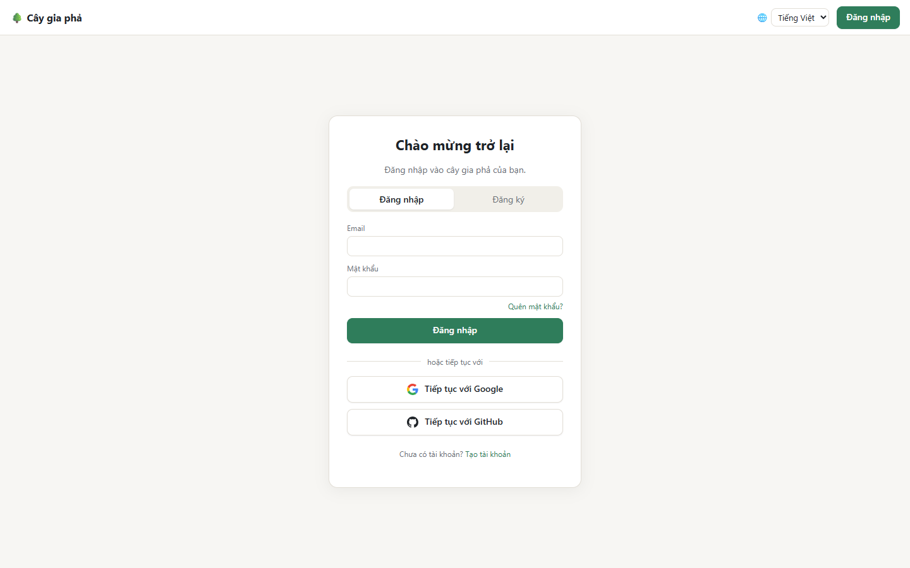

# Bắt đầu

## 1. Tạo tài khoản hoặc đăng nhập

Mở trang web, bạn sẽ thấy màn hình đăng nhập.

Có hai cách:

- **Dùng email và mật khẩu:** chọn thẻ **Đăng ký**, nhập họ tên, email và mật khẩu (ít nhất 8 ký tự), rồi bấm **Tạo tài khoản**. Ứng dụng gửi cho bạn một email xác nhận: hãy mở email và bấm vào liên kết trong đó. Trước khi xác nhận, bạn sẽ thấy màn hình *Kiểm tra hộp thư của bạn*; nếu không thấy email, xem thư mục Spam hoặc bấm **Gửi lại email xác minh**.
- **Dùng Google hoặc GitHub:** bấm **Tiếp tục với Google** (hoặc GitHub). Không cần mật khẩu riêng và không cần xác nhận email.

Lần sau, chỉ cần chọn **Đăng nhập** với đúng cách bạn đã dùng. Quên mật khẩu? Bấm **Quên mật khẩu?** để nhận email đặt lại.

> **Được người thân mời?** Hãy bấm vào liên kết trong email mời. Nếu đăng ký từ liên kết đó bằng đúng địa chỉ email được mời, tài khoản của bạn được xác nhận luôn và bạn vào thẳng cây gia phả được chia sẻ. Xem thêm ở [Chia sẻ và phân quyền](Chia-se-va-phan-quyen#nhận-lời-mời).

## 2. Cây gia phả đầu tiên của bạn

Mỗi tài khoản có sẵn **một cây gia phả riêng**, mang tên bạn (ví dụ *Gia phả của Nguyễn Văn An*). Chỉ bạn và những người bạn mời mới xem được cây này. Bạn có thể đổi tên cây trong [Cài đặt](Cai-dat-va-tai-khoan).

Cây mới thì đang trống. Bạn có hai lựa chọn:

- Bấm **Thêm người đầu tiên** và bắt đầu từ chính bạn, hoặc từ cụ tổ của dòng họ.
- Bấm **Thêm gia đình mẫu** để thử trước với một gia đình mẫu 24 người, 5 đời. Bạn có thể sửa hoặc xóa họ sau.

Sau khi đã có vài người, cách nhanh nhất để thêm tiếp là chọn một người rồi dùng **Thêm người thân** (xem [Thêm và sửa thông tin](Them-va-sua-thong-tin)). Nếu gia đình đã có sẵn danh sách trên Excel, hãy [nhập cả danh sách một lần](Danh-sach-va-nhap-du-lieu).

## 3. Thanh trên cùng

| Mục | Dùng để |
| --- | --- |
| Ô chọn cây (bên cạnh logo) | Chuyển giữa **Các cây của tôi** và các cây **Được chia sẻ với tôi**. Chọn **+ Cây mới…** để tạo thêm một cây. |
| **Cây gia phả** | Xem cây (trang chính). |
| **Thành viên** | Danh sách mọi người trong cây, có ô tìm kiếm. |
| **Nhập dữ liệu** | Nhập danh sách từ tệp Excel hoặc CSV. |
| **Chia sẻ** | Mời người khác và quản lý quyền (chỉ chủ sở hữu và quản trị viên). |
| **Cài đặt** | Tên cây, âm lịch / dương lịch, và các tùy chọn khác. |
| 🌐 **Tiếng Việt / English** | Đổi ngôn ngữ. Lựa chọn được ghi nhớ trên máy. |
| Tên của bạn | Mở **Tài khoản của tôi**: mật khẩu, nhắc ngày giỗ. |

Một tài khoản có thể có **nhiều cây** (tối đa 20 cây do bạn làm chủ), ví dụ một cây cho họ nội và một cây cho họ ngoại, mỗi cây chia sẻ cho những người khác nhau.

**Tiếp theo:** [Xem cây gia phả](Xem-cay-gia-pha)
