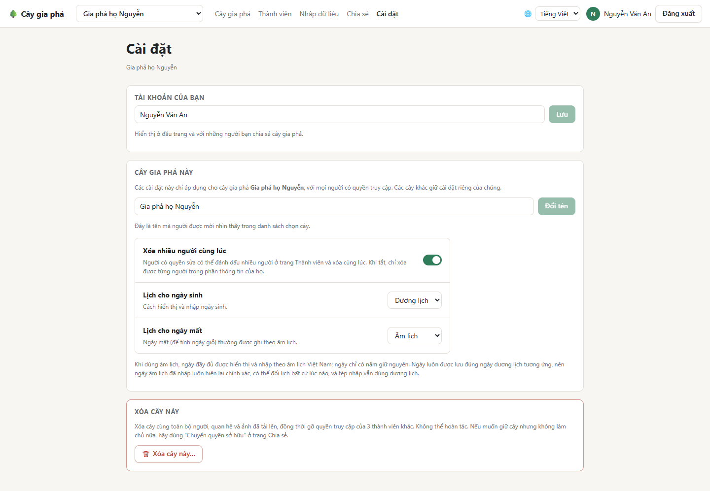

# Cài đặt và tài khoản

## Trang Cài đặt

### Tài khoản của bạn

Đổi **tên hiển thị** của bạn: tên hiện ở góc trên bên phải và với những người bạn chia sẻ cây.

### Cây gia phả này

Các mục này chỉ áp dụng cho **cây đang chọn**, với mọi người có quyền truy cập cây đó. Chỉ **chủ sở hữu** và **quản trị viên** mới thay đổi được.

- **Đổi tên** cây. Tên này hiện trong ô chọn cây của mọi thành viên, ví dụ *Gia phả họ Nguyễn*.
- **Xóa nhiều người cùng lúc:** khi bật, trang **Thành viên** có ô đánh dấu để xóa nhiều người một lần. Tắt đi nếu muốn tránh xóa nhầm.

### Âm lịch và dương lịch

- **Lịch cho ngày sinh** và **Lịch cho ngày mất** được chọn riêng: **Dương lịch** hoặc **Âm lịch**.
- Nhiều gia đình ghi ngày sinh theo dương lịch và ngày mất theo âm lịch để tính ngày giỗ, như trong hình.

Khi chọn **Âm lịch**:

- Ngày đầy đủ hiện theo âm lịch Việt Nam, ví dụ *Ngày 17 tháng 7 năm Ất Dậu (2005) âm lịch*, kèm ngày dương lịch bên dưới. Trên cây chỉ hiện năm âm lịch.
- Khi sửa thông tin, bạn gõ thẳng ngày âm lịch (có ô **Tháng nhuận**), xem [Thêm và sửa thông tin](Them-va-sua-thong-tin#sửa-thông-tin).
- Ngày chỉ có năm thì giữ nguyên.

Đổi qua lại giữa âm lịch và dương lịch **không làm mất hay sai lệch ngày nào**: mỗi ngày âm lịch ứng với đúng một ngày dương lịch, và ứng dụng lưu ngày đó. Lịch âm được tính theo múi giờ Việt Nam, nên khớp với lịch Việt Nam cả những năm khác lịch Trung Quốc (ví dụ Tết Ất Sửu 1985 là ngày 21/1/1985).

### Xóa cây này

Chỉ **chủ sở hữu** thấy mục này. Bấm **Xóa cây này…**, rồi **gõ đúng tên cây** để xác nhận. Cây bị xóa cùng toàn bộ người, quan hệ, ảnh, lời mời và quyền truy cập của mọi thành viên. **Không hoàn tác được.**

> Muốn giữ cây nhưng không làm chủ nữa? Dùng **Chuyển quyền sở hữu** ở trang [Chia sẻ](Chia-se-va-phan-quyen#chuyển-quyền-sở-hữu) thay vì xóa.

## Tạo thêm cây

Mở ô chọn cây (bên cạnh logo) và chọn **+ Cây mới…**, nhập tên (ví dụ *Gia phả họ Trần*). Cây mới trống và thuộc về bạn. Mỗi tài khoản làm chủ tối đa 20 cây.

## Tài khoản của tôi

Bấm vào **tên của bạn** ở góc trên bên phải.

- **Đổi mật khẩu:** nhập mật khẩu hiện tại và mật khẩu mới. Sau khi đổi, các thiết bị khác đang đăng nhập sẽ bị đăng xuất.
- Tài khoản đăng nhập bằng **Google hoặc GitHub** chưa có mật khẩu: bấm **Gửi email liên kết để thêm mật khẩu** nếu muốn đăng nhập thêm bằng email và mật khẩu.
- **Nhắc ngày giỗ:** xem [Nhắc ngày giỗ](Nhac-ngay-gio).

**Đăng xuất:** nút **Đăng xuất** ở góc trên bên phải (trên điện thoại: trong menu **☰**).

**Tiếp theo:** [Dùng trên điện thoại](Dung-tren-dien-thoai)
