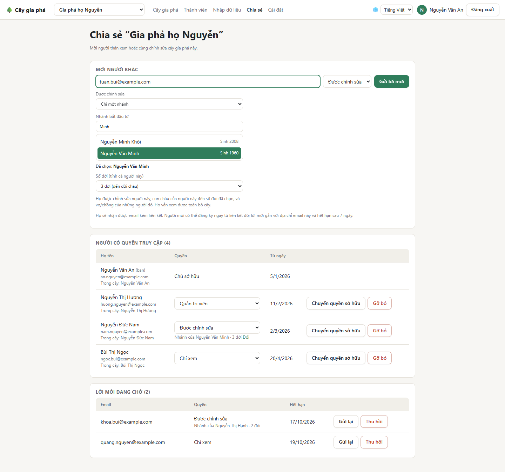
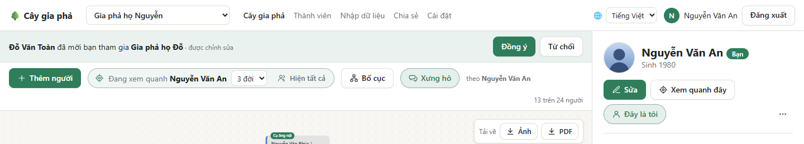

# Chia sẻ và phân quyền

Cây của bạn là **riêng tư**: chỉ những người bạn mời mới thấy. Mỗi người được mời có một **quyền** trong cây đó.

## Các quyền

| Quyền | Được làm gì |
| --- | --- |
| **Chủ sở hữu** | Mọi việc: thêm, sửa, xóa; mời người khác; đặt và gỡ **quản trị viên**; chuyển quyền sở hữu; xóa cây. Mỗi cây có đúng một chủ sở hữu. |
| **Quản trị viên** | Sửa toàn bộ cây; mời người khác; đổi quyền và gỡ người **được chỉnh sửa** và **chỉ xem**; đổi tên cây và cài đặt của cây. |
| **Được chỉnh sửa** | Thêm, sửa, xóa người và quan hệ: trên **toàn bộ cây**, hoặc chỉ trong **một nhánh** (xem dưới). |
| **Chỉ xem** | Xem cây và thông tin mọi người, đánh dấu **Đây là tôi**, bật nhắc ngày giỗ. Không sửa được gì. |

Quyền tính **theo từng cây**: bạn có thể là chủ sở hữu cây của mình và chỉ xem trong cây nhà ngoại.

## Mời người khác

Chủ sở hữu và quản trị viên mở trang **Chia sẻ**:

1. Ở **Mời người khác**, nhập email của người thân.
2. Chọn quyền: **Chỉ xem**, **Được chỉnh sửa**, hoặc **Quản trị viên** (chỉ chủ sở hữu mới mời được quản trị viên).
3. Với **Được chỉnh sửa**, chọn tiếp:
   - **Toàn bộ cây**, hoặc
   - **Chỉ một nhánh**: tìm người đứng đầu nhánh ở ô **Nhánh bắt đầu từ**, rồi chọn **Số đời (tính cả người này)**: *1 đời* là chỉ người đó, *2 đời* tới đời con, *3 đời* tới đời cháu…
4. Bấm **Gửi lời mời**.

Người được mời nhận một email kèm liên kết, có hạn **7 ngày**. Lời mời **gắn với đúng địa chỉ email đó**: chuyển tiếp email cho người khác thì họ cũng không dùng được.

### Sửa trong một nhánh

Người được chỉnh sửa *một nhánh* thì vẫn **xem được cả cây**, nhưng chỉ sửa được người đứng đầu nhánh, con cháu của người đó trong số đời đã chọn, và vợ/chồng của những người ấy. Trên cây họ thấy nhãn *Nhánh của Nguyễn Văn Minh · 3 đời*, bấm vào để tới nhánh đó. Cách này hợp để mỗi gia đình tự cập nhật nhánh của mình mà không lo sửa nhầm nhà khác.

## Quản lý người có quyền

Trên trang **Chia sẻ**:

- **Người có quyền truy cập:** đổi quyền bằng ô chọn; **Đổi** để chọn lại nhánh của một người được chỉnh sửa; **Gỡ bỏ** để thu hồi quyền.
- **Lời mời đang chờ:** **Gửi lại** (gửi lại email, thêm 7 ngày) hoặc **Thu hồi**. Mỗi tài khoản gửi tối đa 20 email mời mỗi ngày.

### Chuyển quyền sở hữu

Muốn giao cây cho người khác (ví dụ con cháu sẽ tiếp tục giữ gia phả), chủ sở hữu bấm **Chuyển quyền sở hữu** cạnh người đó và xác nhận. Người đó trở thành chủ sở hữu; bạn vẫn ở lại với quyền **quản trị viên**, và tài khoản của bạn được tạo một cây mới, trống.

## Nhận lời mời

- **Từ email:** bấm vào liên kết. Chưa có tài khoản thì bấm **Tạo tài khoản & tham gia** và đăng ký bằng **đúng email được mời**. Đã có tài khoản thì đăng nhập rồi bấm **Tham gia**.
- **Trong ứng dụng:** lời mời gửi tới email của bạn cũng hiện ở đầu trang cây, với nút **Đồng ý** và **Từ chối**:

Sau khi tham gia, cây mới nằm trong ô chọn cây ở mục **Được chia sẻ với tôi**.

**Rời khỏi một cây:** mở cây đó, bấm vào chỗ trống trên sơ đồ để bỏ chọn, rồi bấm **Rời khỏi cây này** ở khung bên phải. Muốn xem lại, bạn cần được mời lại.

**Tiếp theo:** [Nhắc ngày giỗ](Nhac-ngay-gio)
