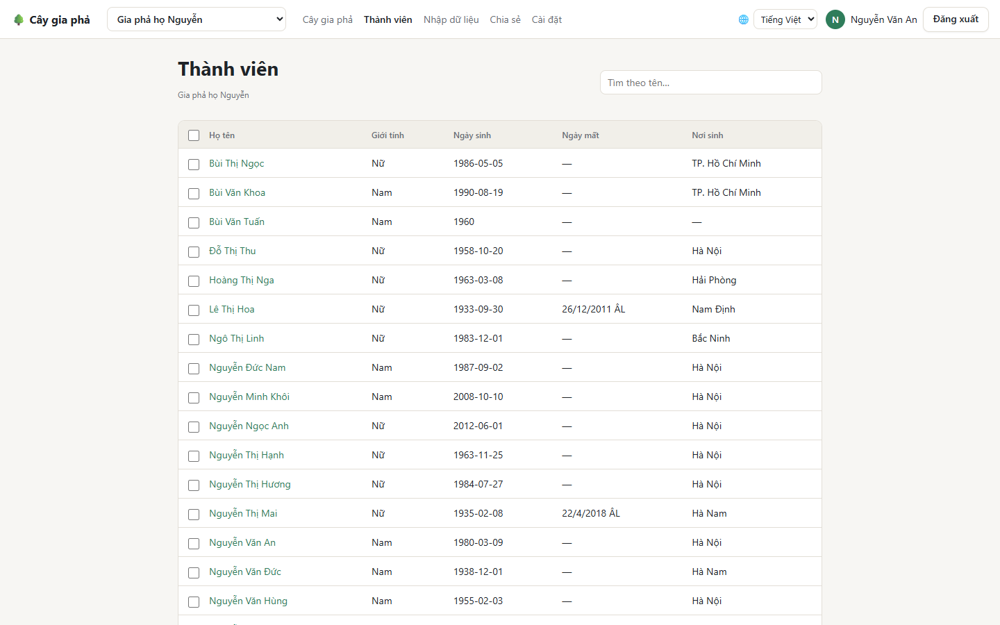
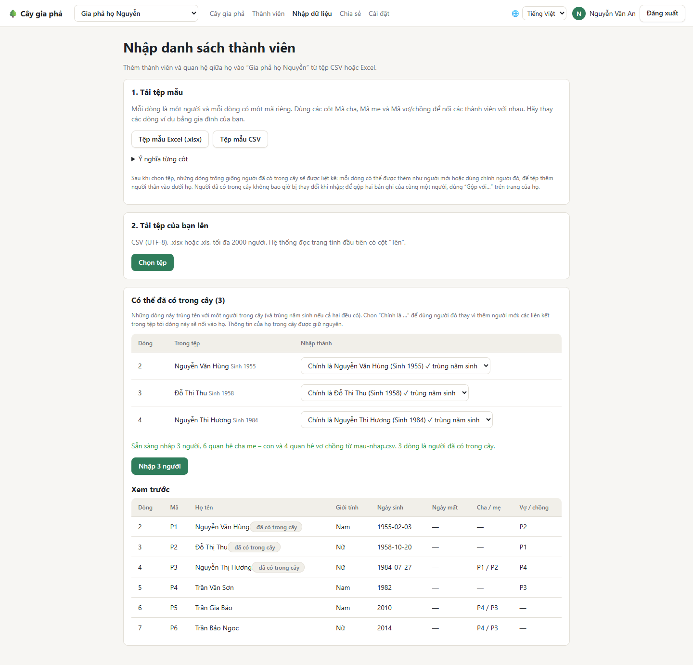

# Thành viên và nhập từ Excel

## Trang Thành viên

Trang **Thành viên** liệt kê mọi người trong cây đang chọn, xếp theo họ tên, kèm giới tính, ngày sinh, ngày mất (theo lịch của cây) và nơi sinh.

- **Tìm kiếm:** gõ vào ô tìm kiếm. Không cần gõ dấu và không cần đúng thứ tự: "an nguyen", "nguyen an" đều tìm ra *Nguyễn Văn An*.
- **Bấm vào một tên** để mở người đó trên cây.

### Xóa nhiều người cùng lúc

Nếu tùy chọn **Xóa nhiều người cùng lúc** đang bật trong [Cài đặt](Cai-dat-va-tai-khoan), mỗi dòng có một ô đánh dấu:

1. Đánh dấu những người cần xóa (ô trên cùng chọn tất cả người đang hiện).
2. Bấm **Xóa người đã chọn** và xác nhận.

Việc xóa không hoàn tác được. Chủ cây có thể tắt tùy chọn này để tránh xóa nhầm.

## Nhập danh sách từ Excel hoặc CSV

Khi gia đình đã có sẵn danh sách (trong sổ, hoặc trên Excel), bạn có thể đưa cả danh sách vào một lần ở trang **Nhập dữ liệu**.

### Bước 1: Tải tệp mẫu

Bấm **Tệp mẫu Excel (.xlsx)** hoặc **Tệp mẫu CSV**. Tệp mẫu có sẵn tên cột tiếng Việt và vài dòng ví dụ. Bấm **Ý nghĩa từng cột** để xem giải thích.

### Bước 2: Điền tệp

Mỗi dòng là **một người**:

| Cột | Ghi gì |
| --- | --- |
| **Mã** | Một mã bất kỳ, không trùng trong tệp: `P1`, `P2`… hoặc `ong_thanh`. Dùng để nối người với người. |
| **Họ**, **Tên** | Ví dụ Họ: `Nguyễn`, Tên: `Văn Thành`. Chỉ cột **Tên** là bắt buộc. |
| **Giới tính** | `Nam`, `Nữ`, `Khác` (hoặc `M`, `F`). |
| **Ngày sinh**, **Ngày mất** | `1930`, `1930-04`, `1930-04-12` hoặc `12/04/1930`, hoặc ô ngày của Excel. Ghi theo **dương lịch**. |
| **Nơi sinh**, **Địa chỉ**, **Tiểu sử** | Không bắt buộc. |
| **Mã cha**, **Mã mẹ** | Mã của cha, của mẹ người này, ở một dòng khác trong tệp. |
| **Mã vợ/chồng** | Mã của vợ hoặc chồng. Nhiều người thì cách nhau bằng dấu `;`. |

> **Mẹo với Excel:** Excel hay tự đổi `1950-03` thành một ngày đầy đủ. Hãy gõ `'1950-03` (có dấu nháy đơn ở đầu) để giữ nguyên.

### Bước 3: Tải tệp lên và kiểm tra

Bấm **Chọn tệp**. Ứng dụng đọc tệp ngay trên máy bạn và **kiểm tra trước, chưa ghi gì cả**:

- **Lỗi** (thiếu tên, trùng mã, mã cha không có trong tệp, ngày chết trước ngày sinh, cha mẹ chưa hơn con 16 tuổi…) được liệt kê kèm số dòng trong tệp. Sửa tệp rồi tải lên lại.
- **Xem trước** liệt kê những người sẽ được nhập.

### Bước 4: Những người đã có trong cây

Nếu một dòng **trùng tên với một người đã có trong cây** (và trùng năm sinh, nếu cả hai đều có), dòng đó hiện ở mục **Có thể đã có trong cây**. Với mỗi dòng, chọn:

- **Người mới:** thêm như một người mới.
- **Chính là …:** dùng người đã có trong cây. Ứng dụng không tạo người mới cho dòng này, và các dòng khác trong tệp lấy người đó làm cha, mẹ hay vợ/chồng sẽ được nối thẳng vào người đã có.

Những dòng trùng cả năm sinh có dấu **✓ trùng năm sinh** và được chọn sẵn là *Chính là …*.

Nhờ vậy bạn có thể **nhập tiếp một nhánh mới vào dưới một người đã có**: trong tệp, thêm một dòng cho người đã có (ví dụ ông *Nguyễn Văn Hùng*), chọn *Chính là Nguyễn Văn Hùng*, rồi ghi mã của dòng đó vào cột **Mã cha** của các con, cháu mới. Thông tin của người đã có trong cây không bị thay đổi.

### Bước 5: Nhập

Bấm **Nhập … người**. Hoặc nhập **toàn bộ** tệp, hoặc không nhập gì nếu có lỗi: không bao giờ nhập dở dang. Mỗi lần tối đa 2000 người.

> Chỉ chủ sở hữu, quản trị viên và người được chỉnh sửa **toàn bộ cây** mới nhập được. Người chỉ được sửa một nhánh thì thêm từng người bằng **Thêm người thân**.

**Tiếp theo:** [Chia sẻ và phân quyền](Chia-se-va-phan-quyen)
