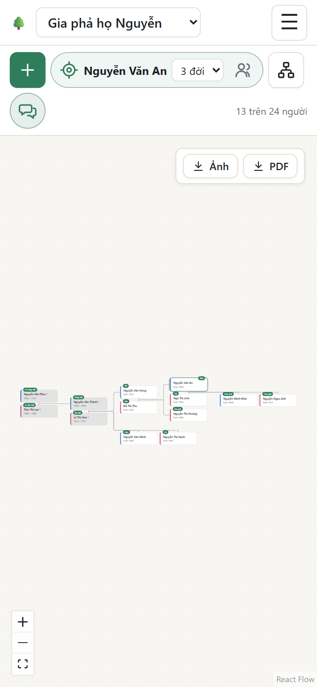
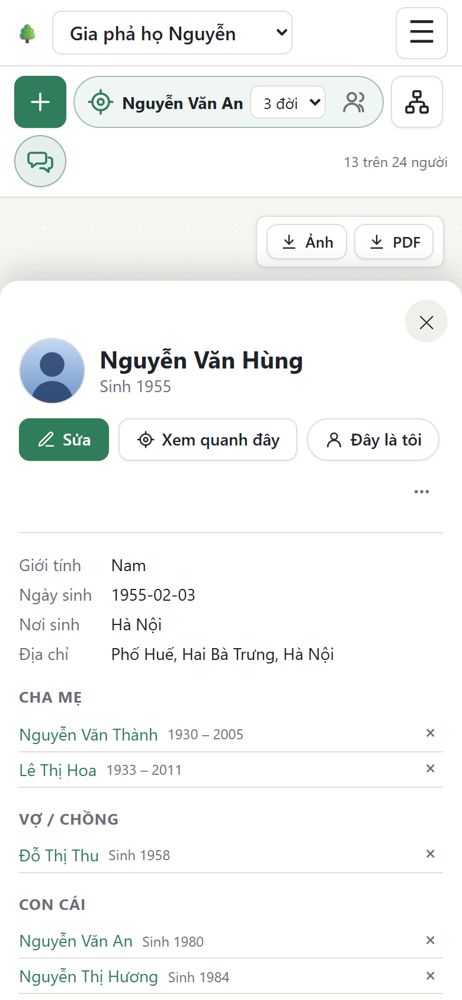
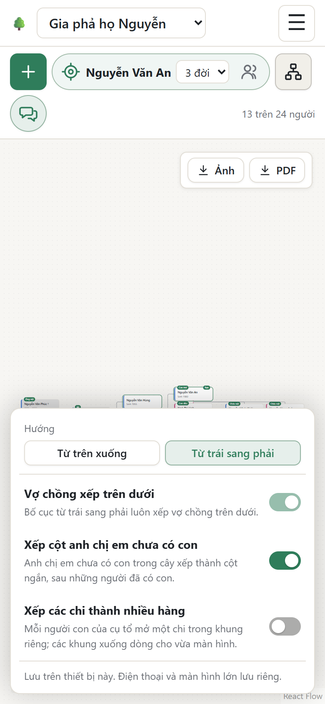

# Dùng trên điện thoại

Không cần cài ứng dụng: mở trang web bằng trình duyệt trên điện thoại (Safari, Chrome…). Mọi chức năng đều có, giao diện được sắp lại cho màn hình nhỏ.

<table>
  <tr>
    <td width="33%"></td>
    <td width="33%"></td>
    <td width="33%"></td>
  </tr>
  <tr>
    <td>Cây gia phả</td>
    <td>Thông tin một người</td>
    <td>Bố cục</td>
  </tr>
</table>

## Khác gì so với máy tính

- **Menu ☰** ở góc trên bên phải chứa các trang (Cây gia phả, Thành viên, Nhập dữ liệu, Chia sẻ, Cài đặt), ngôn ngữ, tài khoản và nút đăng xuất.
- **Thanh công cụ chỉ hiện biểu tượng** cho gọn. Nhấn giữ một nút để xem tên:

  | Biểu tượng | Nút |
  | --- | --- |
  | **+** | Thêm người |
  | ⊙ (khung tròn có tên) | Đang xem quanh ai, và chọn số bước |
  | 👥 (trong khung tròn) | Hiện tất cả |
  | 👤 | Quanh tôi |
  | Sơ đồ ba ô | Bố cục |
  | Hai bong bóng chat | Xưng hô |

- **Cây xếp từ trái sang phải**: mỗi đời là một cột, bạn chủ yếu vuốt lên xuống. Có thể đổi trong **Bố cục**; điện thoại nhớ lựa chọn riêng, không ảnh hưởng máy tính.
- **Chạm vào một thẻ** để mở thông tin người đó: khung thông tin **trượt lên từ dưới**. Chạm **✕** để đóng (người đó vẫn được chọn, nhãn xưng hô vẫn còn).
- **Di chuyển cây** bằng một ngón tay; **chụm hoặc mở hai ngón** để thu nhỏ, phóng to.
- **Chụp ảnh chân dung** trực tiếp: trong **Sửa** → **Tải ảnh lên…** → **Chụp ảnh** (camera sau), rồi chỉnh ảnh bằng ngón tay. Xem [Ảnh chân dung](Them-va-sua-thong-tin#ảnh-chân-dung).

> **Mẹo:** đánh dấu **Đây là tôi** cho chính mình. Mỗi lần mở trên điện thoại, cây sẽ hiện ngay những người gần bạn, nhẹ và nhanh hơn nhiều so với cả cây.

**Tiếp theo:** [Câu hỏi thường gặp](Cau-hoi-thuong-gap)
