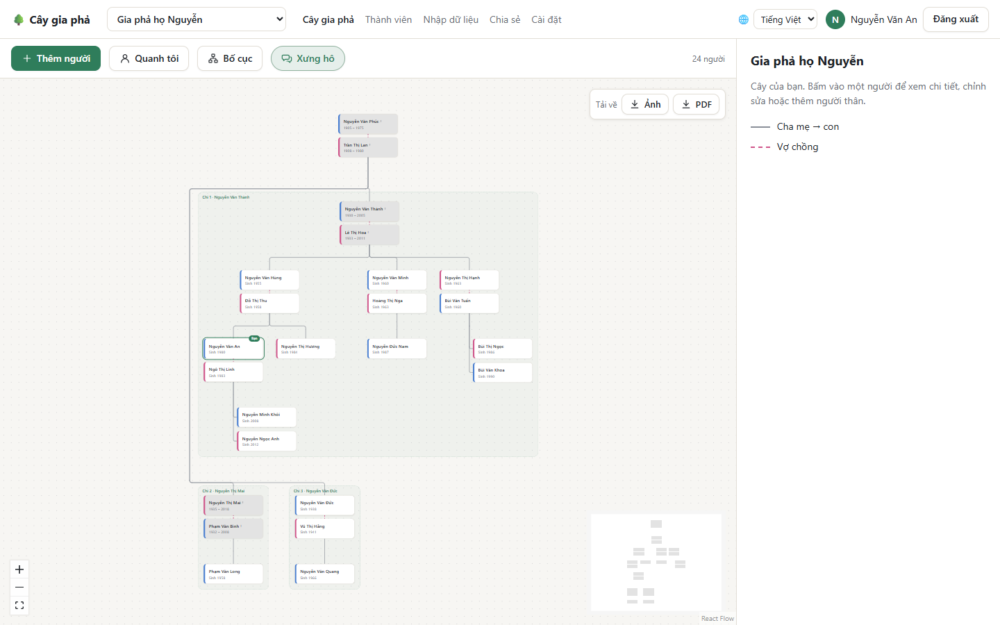

# Cây gia phả: hướng dẫn sử dụng

**Cây gia phả** là trang web giúp cả gia đình cùng ghi lại, xem và gìn giữ gia phả: ai là con ai, ai lấy ai, ngày sinh, ngày mất, quê quán, ảnh và đôi dòng tiểu sử của từng người. Bạn có thể dùng trên máy tính, máy tính bảng hoặc điện thoại, bằng tiếng Việt hoặc tiếng Anh.

> Mọi hình ảnh trong hướng dẫn này dùng **dữ liệu mẫu**: các tên, ngày tháng, email đều do chúng tôi đặt ra, không phải người thật.

## Ứng dụng làm được gì

- **Vẽ cây gia phả** từ những người bạn nhập vào, nhiều đời, với vợ chồng và con cháu. Bấm vào một người để xem đầy đủ thông tin.
- **Cách xưng hô kiểu Việt Nam:** chọn một người, cây sẽ ghi cách người đó gọi từng người thân: ông nội, bà ngoại, chú, cô, con dâu, cháu nội…
- **Âm lịch:** ngày mất (và ngày sinh, nếu muốn) có thể ghi và hiển thị theo âm lịch Việt Nam, kèm năm can chi.
- **Nhắc ngày giỗ qua email**, trước bao nhiêu ngày tùy bạn chọn.
- **Cùng nhau làm gia phả:** mời người thân xem hoặc cùng chỉnh sửa, có thể giới hạn mỗi người chỉ sửa nhánh của mình.
- **Ảnh chân dung:** chụp bằng điện thoại (kể cả chụp lại ảnh cũ), cắt, xoay, chỉnh thẳng ngay trên trang.
- **Nhập từ Excel** cả danh sách dài, và **tải cây về** dưới dạng ảnh hoặc PDF để in.
- **Riêng tư:** chỉ bạn và những người bạn mời mới thấy cây của bạn.

## Đọc theo thứ tự nào

Nếu bạn mới dùng lần đầu, hãy đọc theo thứ tự:

1. [Bắt đầu](Bat-dau): tạo tài khoản và cây gia phả đầu tiên.
2. [Xem cây gia phả](Xem-cay-gia-pha): di chuyển, chọn người, xưng hô, bố cục.
3. [Thêm và sửa thông tin](Them-va-sua-thong-tin): thêm người thân, ảnh, ngày âm lịch.
4. [Chia sẻ và phân quyền](Chia-se-va-phan-quyen): mời cả nhà cùng xem và cùng làm.

Khi cần:

- [Danh sách thành viên và nhập từ Excel](Danh-sach-va-nhap-du-lieu)
- [Nhắc ngày giỗ](Nhac-ngay-gio)
- [Cài đặt và tài khoản](Cai-dat-va-tai-khoan)
- [Dùng trên điện thoại](Dung-tren-dien-thoai)
- [Câu hỏi thường gặp](Cau-hoi-thuong-gap)
