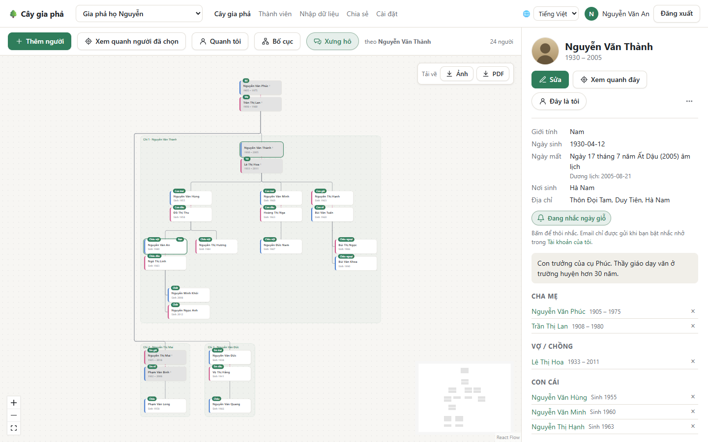
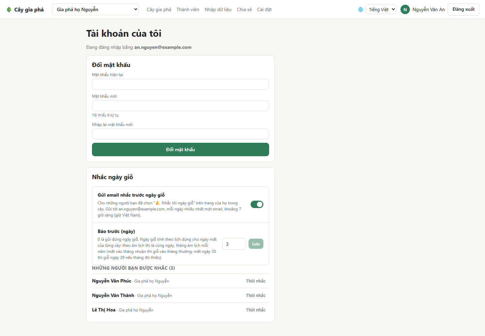

# Nhắc ngày giỗ

Ứng dụng có thể gửi **email nhắc trước ngày giỗ** của những người bạn chọn. Mọi thành viên đều dùng được, kể cả người **chỉ xem**. Mỗi người tự chọn cho mình.

## 1. Chọn người cần nhắc

Mở người đã mất trên cây. Nếu người đó có **ngày mất đầy đủ** (ngày, tháng, năm), khung thông tin có nút **Nhắc tôi ngày giỗ**. Bấm vào để bật; nút chuyển thành **Đang nhắc ngày giỗ**. Bấm lần nữa để tắt.

## 2. Bật gửi email và chọn báo trước mấy ngày

Bấm vào tên của bạn ở góc trên bên phải để mở **Tài khoản của tôi**, tới mục **Nhắc ngày giỗ**:

- Bật **Gửi email nhắc trước ngày giỗ**.
- **Báo trước (ngày):** từ `0` (đúng ngày giỗ) tới `30`, mặc định `3`. Bấm **Lưu**.
- Danh sách bên dưới là những người bạn đang được nhắc; **Thôi nhắc** để bỏ một người.

## Email trông như thế nào

Mỗi ngày tối đa **một email**, khoảng **7 giờ sáng** giờ Việt Nam, gửi tới email tài khoản của bạn, liệt kê mọi ngày giỗ sắp tới. Ví dụ:

> **Nhắc ngày giỗ: còn 3 ngày nữa – Nguyễn Văn Thành**
>
> Giỗ Nguyễn Văn Thành (Gia phả họ Nguyễn): 29/08/2026 (ngày 17 tháng 7 năm Bính Ngọ âm lịch)

Email viết bằng ngôn ngữ bạn dùng gần nhất trong ứng dụng.

## Ngày giỗ được tính thế nào

Theo lịch của ngày mất trong [Cài đặt](Cai-dat-va-tai-khoan#âm-lịch-và-dương-lịch) của từng cây:

- **Âm lịch:** cùng ngày, cùng tháng âm lịch mỗi năm. Theo phong tục, người mất vào **tháng nhuận** thì giỗ vào tháng thường cùng số; người mất **ngày 30** thì những năm tháng đó thiếu, giỗ vào **ngày 29**.
- **Dương lịch:** cùng ngày, cùng tháng mỗi năm. Người mất ngày 29/2 thì những năm không nhuận được nhắc vào 28/2.

> Cần ghi **đủ ngày, tháng, năm** của ngày mất. Ngày mất chỉ có năm, hoặc năm và tháng, thì không tính được ngày giỗ.

**Tiếp theo:** [Cài đặt và tài khoản](Cai-dat-va-tai-khoan)
