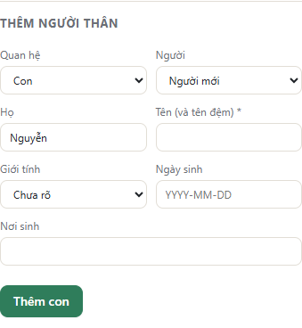
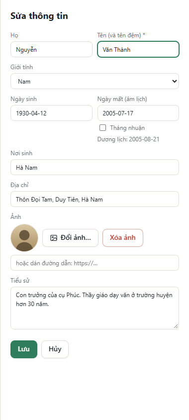
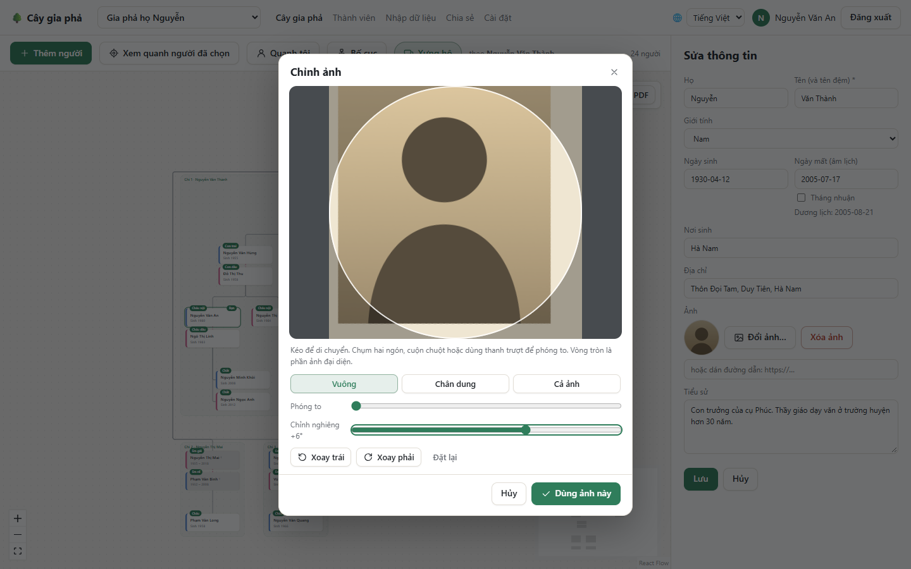

# Thêm và sửa thông tin

> Bạn cần quyền **chủ sở hữu**, **quản trị viên** hoặc **được chỉnh sửa** để thêm và sửa. Người **chỉ xem** vẫn xem được mọi thông tin. Xem [Chia sẻ và phân quyền](Chia-se-va-phan-quyen).

## Khung thông tin của một người

Bấm vào một người trên cây để mở khung thông tin bên phải:

- **Ảnh** (bấm vào để xem ảnh lớn), họ tên, năm sinh và năm mất.
- Các nút **Sửa**, **Xem quanh đây**, **Đây là tôi**, và nút **⋯** (thao tác khác: **Gộp với…**, **Xóa**).
- Giới tính, ngày sinh, ngày mất (âm lịch nếu cây dùng âm lịch, kèm ngày dương lịch bên dưới), nơi sinh, địa chỉ, tiểu sử.
- Nút **Nhắc tôi ngày giỗ** cho người đã mất (xem [Nhắc ngày giỗ](Nhac-ngay-gio)).
- Danh sách **Cha mẹ**, **Vợ / chồng**, **Con cái**. Bấm vào tên để chuyển sang người đó. Dấu **×** bên cạnh gỡ quan hệ (không xóa người).

## Thêm người thân

Cách nhanh nhất để mở rộng cây. Ở cuối khung thông tin có mục **Thêm người thân**:

1. Ở ô **Quan hệ**, chọn **Con**, **Cha / mẹ** hoặc **Vợ / chồng** của người đang xem.
2. Ở ô **Người**, chọn:
   - **Người mới:** điền họ, tên, giới tính, ngày sinh, nơi sinh.
   - **Người đã có trong cây:** tìm theo tên (không cần gõ dấu: gõ "nguyen an" cũng tìm ra "Nguyễn Văn An").
3. Bấm **Thêm con** (hoặc **Thêm cha / mẹ**, **Thêm vợ / chồng**).

Ứng dụng giúp tránh nhầm lẫn:

- **Cha mẹ phải hơn con ít nhất 16 tuổi** (khi đã biết năm sinh). Những người không thỏa mãn sẽ hiện mờ kèm lý do.
- **Không ai được là tổ tiên của chính mình** (ví dụ nhận nhầm cháu làm ông).
- Một người con nên có cả cha lẫn mẹ: thêm con cho người chồng, rồi mở người con đó và chọn **Cha / mẹ → Người đã có trong cây** để nối với người vợ.

Muốn thêm một người chưa có quan hệ với ai, dùng nút **Thêm người** trên thanh công cụ.

## Sửa thông tin

Bấm **Sửa** trong khung thông tin:

**Cách ghi ngày tháng:** gõ theo dạng `NĂM-THÁNG-NGÀY`, ví dụ `1930-04-12`. Gia phả thường không nhớ đủ ngày, nên bạn có thể ghi:

| Bạn biết | Ghi là |
| --- | --- |
| Đủ ngày tháng năm | `1930-04-12` |
| Chỉ tháng và năm | `1930-04` |
| Chỉ năm | `1930` |

**Ngày theo âm lịch:** nếu cây dùng âm lịch cho ngày mất (xem [Cài đặt](Cai-dat-va-tai-khoan#âm-lịch-và-dương-lịch)), ô ghi là **Ngày mất (âm lịch)**. Bạn gõ ngày âm lịch, ví dụ `2005-07-17` là ngày 17 tháng 7 năm Ất Dậu. Nếu là tháng nhuận, đánh dấu **Tháng nhuận**. Ngay bên dưới hiện ngày dương lịch tương ứng để bạn kiểm tra. Ngày âm lịch không có thật (ví dụ ngày 30 của tháng thiếu) sẽ bị báo lỗi. Với âm lịch, hãy ghi đủ ngày tháng năm, hoặc chỉ năm.

Bấm **Lưu** để lưu, **Hủy** để bỏ.

## Ảnh chân dung

Trong khung sửa thông tin, mục **Ảnh**:

- **Trên máy tính:** bấm **Tải ảnh lên…** (hoặc **Đổi ảnh…**) để chọn tệp ảnh.
- **Trên điện thoại, máy tính bảng:** nút đó mở menu: **Chụp ảnh** (mở camera sau, tiện để chụp lại ảnh cũ trong album, trên bàn thờ) hoặc **Chọn ảnh có sẵn**.

Sau khi chụp hoặc chọn, ảnh mở trong khung **Chỉnh ảnh**:

- **Kéo** để di chuyển ảnh; chụm hai ngón, lăn chuột hoặc dùng thanh **Phóng to** để phóng to.
- **Khung:** **Vuông**, **Chân dung** (3:4) hoặc **Cả ảnh**. Vòng tròn cho biết phần sẽ hiện trong ảnh đại diện tròn.
- **Chỉnh nghiêng:** xoay nhẹ tới 20° để làm thẳng ảnh chụp bị nghiêng. **Xoay trái / Xoay phải** xoay từng góc vuông.
- Bấm **Dùng ảnh này**, rồi **Lưu** để lưu thông tin. Ảnh chỉ được tải lên khi bấm **Lưu**.

Bạn cũng có thể dán đường dẫn của một ảnh có sẵn trên mạng (`https://…`). **Xóa ảnh** gỡ ảnh khỏi người đó.

> Ảnh tải lên chỉ những thành viên của cây mới xem được.

## Xóa một người

Nút **⋯** → **Xóa**. Mọi quan hệ của người đó cũng bị xóa (những người khác vẫn còn). Việc này không hoàn tác được. Muốn xóa nhiều người cùng lúc, xem [Thành viên](Danh-sach-va-nhap-du-lieu#xóa-nhiều-người-cùng-lúc).

## Một người bị nhập hai lần: Gộp

Khi một người có hai thẻ trong cây (do nhập hai lần, hoặc hai người cùng thêm), hãy gộp lại:

1. Mở người muốn **giữ lại**, bấm **⋯** → **Gộp với…**
2. Tìm và chọn bản ghi còn lại. Cha mẹ, con và vợ/chồng của chính người này không hiện trong danh sách.
3. Hai bản ghi hiện cạnh nhau. Ở mục nào hai bên khác nhau, chọn giá trị muốn giữ. Giá trị chỉ một bên có sẽ tự được giữ.
4. Bấm **Gộp**. Toàn bộ cha mẹ, con, vợ/chồng của bản ghi kia được chuyển sang người được giữ, rồi bản ghi kia bị xóa.

Ứng dụng không cho gộp hai người là cha mẹ, con hay vợ chồng của nhau.

**Tiếp theo:** [Chia sẻ và phân quyền](Chia-se-va-phan-quyen)
