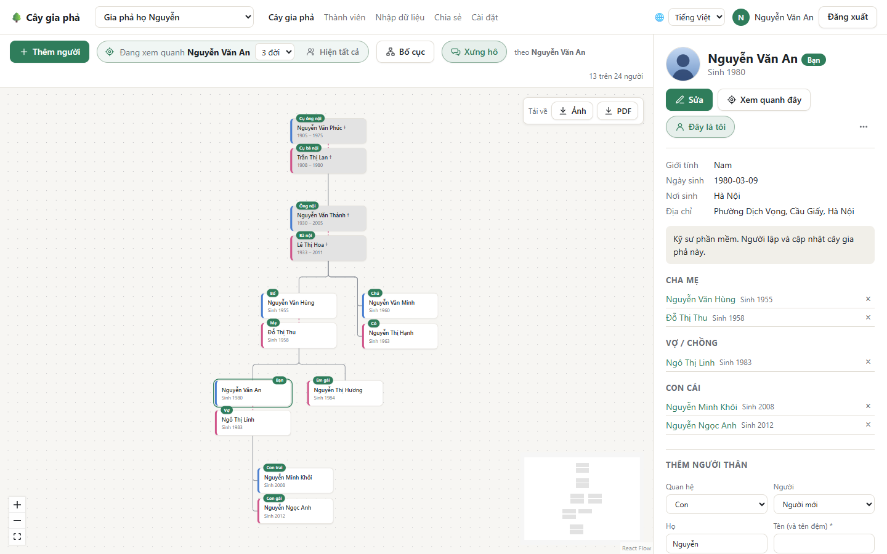
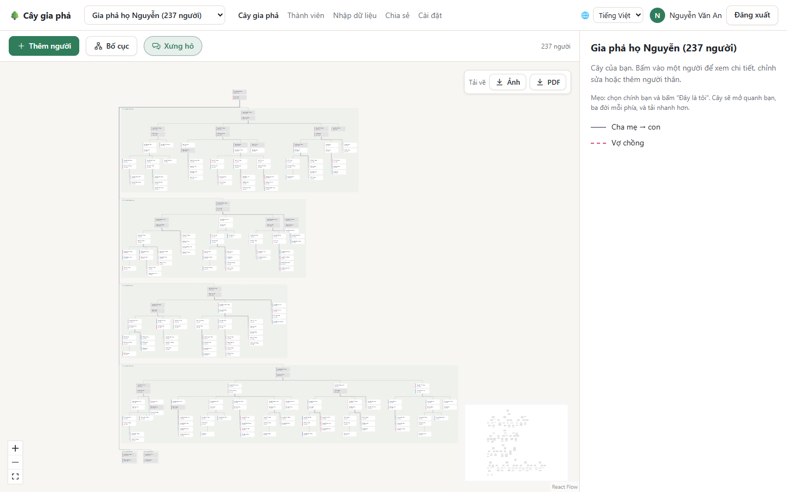
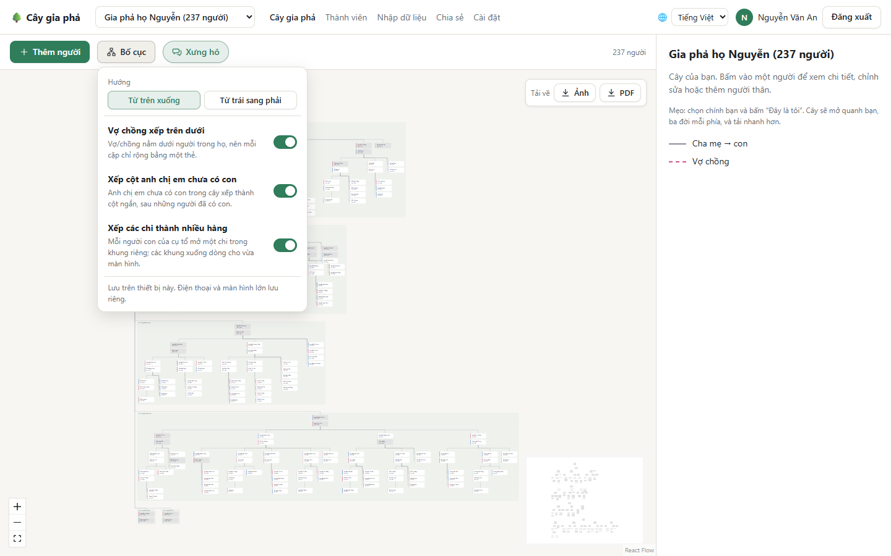

# Xem cây gia phả

Trang **Cây gia phả** là trang chính: bên trái là sơ đồ cây, bên phải là thông tin của người bạn chọn.

## Đọc sơ đồ

- Mỗi **thẻ** là một người: họ tên và năm sinh, năm mất. Vạch màu bên trái thẻ cho biết giới tính (xanh: nam, hồng: nữ). Người đã mất có thẻ màu xám và dấu † sau tên.
- **Đường liền** nối cha mẹ với con. **Đường gạch hồng** nối vợ chồng.
- Thẻ có nhãn **Bạn** là chính bạn (xem [Đây là tôi](#đây-là-tôi)).
- Con cái xếp từ trái sang phải theo năm sinh, con cả bên trái.

**Di chuyển:** kéo nền để di chuyển; lăn chuột, hoặc dùng nút **+** / **−** ở góc dưới bên trái, để phóng to, thu nhỏ; nút **⛶** đưa cả cây vừa màn hình. Ô nhỏ ở góc dưới bên phải là bản đồ thu nhỏ của cả cây, có thể kéo để đi nhanh tới một chỗ.

**Bấm vào một thẻ** để xem thông tin người đó ở khung bên phải. Bấm vào chỗ trống để bỏ chọn.

## Xưng hô

Khi nút **Xưng hô** đang bật (màu xanh), mỗi thẻ có một nhãn nhỏ cho biết **người đang được chọn gọi người đó là gì**: ông nội, bà nội, bố, mẹ, chú, cô, anh trai, em gái, vợ, con trai, cháu nội… Bên cạnh nút có dòng *theo Nguyễn Văn An* để bạn biết đang xưng hô theo ai.

Chọn một người khác thì toàn bộ nhãn đổi theo người đó. Ví dụ ở hình dưới, nhãn được tính theo ông *Nguyễn Văn Thành*:

## Xem quanh một người, hay xem cả cây

Với gia đình đông người, ứng dụng có thể chỉ hiện **những người gần một người nào đó**, cho nhẹ và dễ nhìn:

- Khung **Đang xem quanh Nguyễn Văn An** trên thanh công cụ cho biết cây đang xoay quanh ai. Ô **3 đời** bên cạnh chọn hiện xa tới đâu, tính theo số bước quan hệ (cha mẹ, con, vợ chồng đều là một bước).
- **Hiện tất cả:** hiện cả cây.
- **Xem quanh người đã chọn** (hoặc **Xem quanh đây** trong khung thông tin): xoay cây quanh người đang chọn.
- **Quanh tôi:** quay về quanh chính bạn.

Góc phải thanh công cụ ghi số người đang hiện, ví dụ *13 trên 24 người*.

## Đây là tôi

Hãy tìm thẻ của chính bạn, bấm vào, rồi bấm **Đây là tôi** trong khung thông tin. Từ đó:

- Thẻ của bạn có nhãn **Bạn**.
- Mỗi lần mở, cây **tự xoay quanh bạn** (3 bước mỗi phía) và chọn sẵn bạn, nên cách xưng hô hiện theo bạn.

Liên kết này là của riêng bạn, trong từng cây (mỗi cây bạn có thể là một người khác nhau). Hai thành viên không thể cùng nhận là một người. Bấm lại nút **Đây là tôi** để bỏ liên kết.

## Bố cục: khi gia đình đông người

Với hàng trăm người, nếu xếp mỗi đời trên một hàng thì cây sẽ rất dài và rất hẹp. Vì vậy cây được sắp xếp gọn lại:

Bấm **Bố cục** trên thanh công cụ để điều chỉnh:

| Tùy chọn | Tác dụng |
| --- | --- |
| **Từ trên xuống** / **Từ trái sang phải** | Mỗi đời là một hàng, hoặc mỗi đời là một cột (hợp với điện thoại cầm dọc: chỉ cần vuốt xuống). |
| **Vợ chồng xếp trên dưới** | Vợ/chồng nằm ngay dưới người trong họ, nên mỗi cặp chỉ rộng bằng một thẻ. |
| **Xếp cột anh chị em chưa có con** | Anh chị em chưa có con trong cây được xếp thành cột ngắn, sau những người đã có con. |
| **Xếp các chi thành nhiều hàng** | Mỗi người con của cụ tổ mở một **chi**, nằm trong một khung riêng có tên (*Chi 1 · Nguyễn Văn Thành*). Các khung xuống dòng cho vừa màn hình. |

Máy tính và máy tính bảng mặc định dùng **Từ trên xuống** với cả ba tùy chọn bật. Điện thoại mặc định dùng **Từ trái sang phải**. Lựa chọn của bạn được ghi nhớ trên từng thiết bị; **Về mặc định cho màn hình này** đưa về như ban đầu. Tắt hết các tùy chọn thì cây trở về kiểu cổ điển, mỗi đời một hàng.

## Tải cây về để in

Ô **Tải về** ở góc trên bên phải sơ đồ có hai nút:

- **Ảnh:** tải về tệp PNG.
- **PDF:** tải về tệp PDF một trang, khổ vừa với cây. Khi in, chọn *Vừa với trang* (Fit to page) để in trên khổ giấy bất kỳ.

Ứng dụng tải **toàn bộ phần cây đang hiện** (không chỉ phần vừa màn hình), với tên cây và ngày tải ở phía trên. Muốn in một nhánh, hãy *xem quanh* người đứng đầu nhánh trước rồi mới tải.

**Tiếp theo:** [Thêm và sửa thông tin](Them-va-sua-thong-tin)
